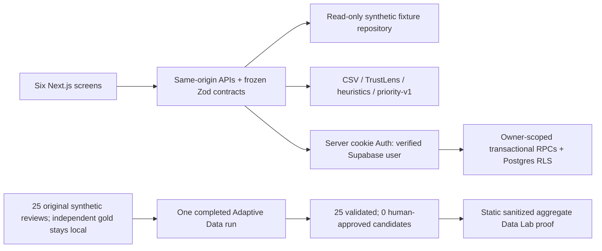

# InsightFlow

**Evidence-first customer feedback, explainable priorities and private action tracking.**

[Explore the live application](https://insightflow-preview-demo.vercel.app/) — all six public modules work without login.

Repeated feedback can inflate apparent demand, denied allegations can look like incidents, and missing dates can produce misleading trends. InsightFlow preserves original evidence, separates records from distinct patterns, and turns supported findings into traceable decisions and actions.

The public app serves **10 authored synthetic records, 9 exact text patterns and 1 repeated row**. These are illustrative examples, not real customer incidents or the competition dataset. Private workspaces use real Supabase persistence. Analysis is explicitly labeled **heuristic**, with mixed/unknown states and no fabricated confidence or accuracy.

## Six modules

| Module | What to explore |
| --- | --- |
| [Command Center](https://insightflow-preview-demo.vercel.app/) | Raw/pattern counts, coverage, categories and supported priorities |
| [Feedback Explorer](https://insightflow-preview-demo.vercel.app/feedback) | Search, filters, pagination, records/pattern views and original evidence |
| [Issue Intelligence](https://insightflow-preview-demo.vercel.app/issues) | Severity, recommendations, evidence, private statuses and saved actions |
| [Decision Studio](https://insightflow-preview-demo.vercel.app/decisions) | Safety/experience/operations objectives, visible weights and hypothetical sensitivity sliders |
| [Executive Reports](https://insightflow-preview-demo.vercel.app/reports) | Dataset-scoped briefing, CSV summary export and print/PDF |
| [Data Lab](https://insightflow-preview-demo.vercel.app/data-lab) | TrustLens integrity, provenance, coverage and truthful Adaption availability |

## TrustLens and explainable priorities

Every accepted original review/category is retained. Unicode case folding, trimming and whitespace normalization produce batch-scoped SHA-256 groups; punctuation and negation remain intact. Exact repeats retain occurrence counts and category memberships. Near-duplicate merging is not implemented. Frequency is shown alongside distinct-pattern evidence, never treated as independent customers.

Absent complaint dates remain null. Ingestion time is provenance, not a complaint date; customer counts and timelines remain unavailable without source evidence. Malformed/oversized CSV input is rejected and invalid semantic rows are reported. The browser upload limit is 4 MiB; the parser ceiling is 5 MiB with bounded request decoding.

Narrow clause rules attach verbatim evidence, exclude denied allegations from issue evidence and retain mixed/unknown states. Priority-v1 combines severity, distinct-pattern share, negative-or-mixed evidence share and evidence coverage. Raw repetition has zero direct weight. Severity receives 70% for safety and 55% for experience/operations; all remaining weights and factors are disclosed. Sliders explore hypothetical rankings, not observed or predicted business outcomes.

## Architecture



Next.js 16 App Router, React 19, TypeScript, Tailwind CSS and frozen Zod domain v1.0.0 contracts power the app. A repository seam serves public fixtures, local official artifacts or private database snapshots. Supabase cookies are HttpOnly, Secure on HTTPS and SameSite=Lax. The server verifies users and write origins; RPCs derive ownership and persist atomically. Direct client table writes are denied. Public fixtures are immutable.

The existing **nonproduction Vercel Hobby Preview** uses only the development Supabase URL and low-privilege publishable key server-side. Test passwords, service-role keys and Adaption keys are not deployment variables. The original read-only Preview is preserved. [Architecture and boundaries](docs/SUBMISSION_ARCHITECTURE.md) · [API contracts](docs/API_CONTRACT.md) · [private batch protocol](docs/BATCH_API_CONTRACT.md).

## Adaption status: one real pilot completed; candidates require review

The local SDK is pinned to **0.14.0**. An authenticated read-only dataset-list request returned actual HTTP 200. A 25-review original synthetic pilot has independent human approval and validated source hashes. Gold labels and reviewer metadata stay local.

One separately authorized Adaptive Data run returned **25 candidates from 25 original synthetic reviews**. All source/hash, structural and verbatim-evidence checks passed. **Zero generated candidates are human-approved; no classifier was trained or activated.** The separate Data Lab section displays only sanitized aggregate proof and actual opaque run provenance. It does not classify the competition dataset, demo fixtures or private batches.

| Independent selected-pilot agreement | Adaption candidates | Existing heuristics |
| --- | --- | --- |
| Sentiment | 16/25 | 2/25 |
| Severity | 6/25 | 2/25 |
| Exact issue-type sets | 6/25 | 9/25 |

Agreement was mixed: issue-set agreement was weaker even though sentiment and severity agreement were higher. Provider dataset grading declined **10.0 → 9.2 (A → A)**, a separate signal from independent label agreement. These are pilot observations, not generalized model accuracy or an overall improvement. Original texts, completions, gold, reviewer information and provider logs stay private. [Public proof and reproduction](docs/DATA_LAB_ADAPTION_PROOF.md).

**Release status:** these integration changes are prepared locally for review. The existing public snapshot and live Preview remain unchanged until the sanitized release is separately approved. Provider commands never run on app startup/build.

Adaptive Data is intended to generate training candidates, not provide live sentiment inference. Future outputs require schema, hash, verbatim-evidence and independent human-label validation before curation. [Current status and real connection proof](docs/ADAPTION_SUBMISSION_STATUS.md).

## Local setup

Use Node.js **24.x** (verified; package minimum 22) and npm. Python 3.11+ is optional for offline tools.

```sh
npm ci
```

For a fresh checkout, copy `.env.example` to the ignored `.env.local`. If it already exists, edit it instead of overwriting credentials. For public exploration use:

```dotenv
INSIGHTFLOW_DATA_MODE=fixture
INSIGHTFLOW_DEPLOYMENT_PROFILE=
INSIGHTFLOW_WRITES_ENABLED=false
APP_ORIGIN=http://localhost:3000
```

Leave Supabase/Adaption fields blank for public exploration. Then run:

```sh
npm run dev
# http://localhost:3000
npm run check
# Production-style local fixture build/start:
npm run build
npm start
```

Install Chromium using `npx playwright install chromium --only-shell`; with the app running, use `npm run smoke`. `npm run smoke:auth` uses labeled Auth/private doubles and does not prove live isolation. Dataset-dependent tests may skip when official files are absent. `npm run test:python` tests offline safeguards, without provider calls.

Private functionality requires approved development Supabase configuration and confirmed email/password users. Read the [setup guide](docs/SUPABASE_PRODUCTION_GUIDE.md), review migrations individually and never run an unrestricted database push against an existing project. Writes remain disabled locally until deliberately authorized. Do not use someone else's credentials or include keys in browser code.

The genuine competition CSV, when legitimately available, belongs only at ignored `data/raw/customer_feedback.csv`. `npm run data:inspect` and `npm run data:prepare` verify and build its local artifact. The existing local source was verified at 7,000 rows / 320 patterns / 6,680 repeats; it is **not included in the repository or public deployment**. Do not invent missing rows or publish/transfer official input without permission.

## Verification and limitations

The prepared aggregate-proof release passes **104 TypeScript tests, 35 Python tests**,
lint, typecheck, local production build, security checks and synthetic browser/API
smoke. These local checks are separate from deployment and live Auth acceptance.

Phase 7B passed **97 TypeScript tests, 23 Python tests and 32 real hosted Auth/private checks**, plus lint/typecheck/build/security/packaging and browser smoke checks. Real imports, manual feedback, persisted actions, owner isolation, exports, logout and account switching were verified. [Sanitized hosted evidence](docs/PHASE7B_PREVIEW.md) distinguishes live operations from doubles.

- Heuristics have limited vocabulary coverage and are not a trained classifier; no model accuracy is claimed.
- No customer identities/dates are inferred. Suspected fraud is an allegation, not a legal finding.
- Natural JWT expiry/forced browser token rotation and signup/recovery/email-link flows were not acceptance-tested. Already-issued JWTs may remain valid until expiry under owner RLS.
- Authenticated Preview writes are enabled for private development workspaces; anonymous visitors cannot import or save actions.
- Official transfer permission remains unresolved. The completed pilot uses original synthetic data; structural validity does not prove semantic correctness.

## Submission materials

[90-second demo script](docs/DEMO_90_SECONDS.md) · [checklist and publishing plan](docs/SUBMISSION_CHECKLIST.md) · [security audit](docs/SUBMISSION_SECURITY_AUDIT.md).

[Public source repository](https://github.com/yashshah1211/InsightFlow) is published at the approved sanitized snapshot `3939daf52dd47b222c5acf04498f304fb3be5a1b`; the new aggregate-proof release is prepared locally and has not been pushed. [Publication receipt](docs/SUBMISSION_PUBLICATION.md). The recorded-video URL is still pending. Exact submission deadline, timezone and submission URL: **Awaiting organizer confirmation.** Built by a solo participant using AI-assisted development; the architecture and limitations are documented for explanation. No competition submission is claimed.
