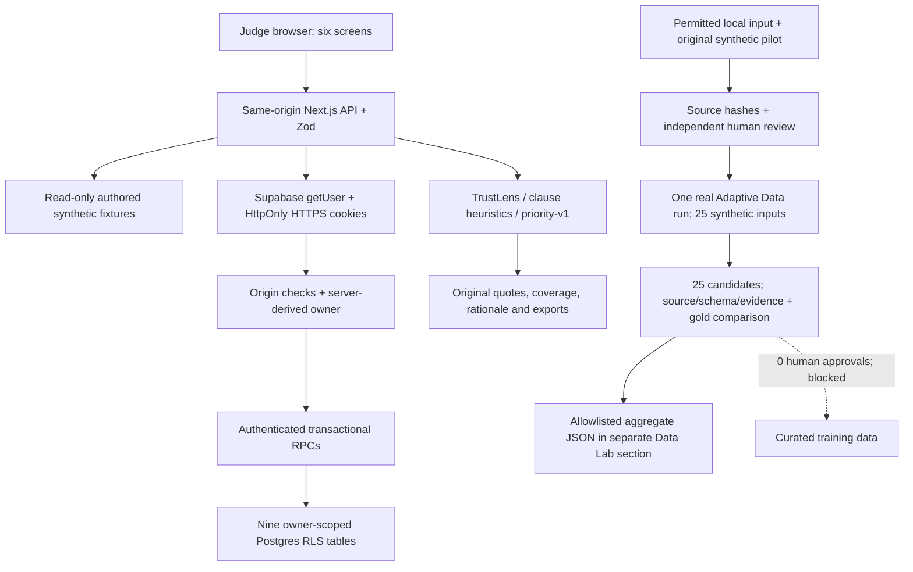

# Submission architecture and integration

Current live reference: https://insightflow-preview-demo.vercel.app/.

Solid paths are implemented locally. The new static proof is awaiting release
approval; existing public deployment remains unchanged. The dashed curation
path requires genuine candidate approval and has not produced training rows.

The browser uses application APIs, not privileged database credentials. Frozen
domain v1.0.0, additive Auth and batch protocols validate boundaries. Private
selection is discovered and reauthorized server-side; storing an ID grants no
access. Public fixtures and private snapshots share the repository interface.

CSV import preserves raw rows and exact batch-scoped groups, then atomically
persists feedback, patterns, heuristic annotations, issues and evidence. A content
hash makes identical same-owner retries idempotent. Issue UUIDs/actions persist;
workspace foreign keys, owner RPCs and RLS enforce isolation. Direct client table
writes remain denied. Sign-out clears private selection and rendered state.

TrustLens separates volume from distinct evidence. Priority uses severity and
disclosed evidence factors; repeats have no direct scoring weight. Unsupported
dates, customer counts, confidence, credits and evaluation metrics remain absent.

The official-artifact pipeline remains local and is excluded from deployment.
The 25-review original synthetic Adaption pilot keeps independent gold locally.
The completed provider payload contained only source review text and normalized
hashes with the approved task/schema. Returned completions are unreviewed training
candidates, not independent ground truth. No custom model was trained. The public
proof contains only actual opaque provenance, aggregate counts/comparisons and
limitations; gold, source texts, completions and account data remain local.

Independent agreement: sentiment 16/25 versus heuristic 2/25; severity 6/25 versus
2/25; exact issue sets 6/25 versus 9/25. Provider grading declined 10.0 to 9.2
(A to A). This selected synthetic pilot does not establish generalized accuracy
or overall improvement. All live feedback analytics remain heuristic.
See [Data Lab proof](DATA_LAB_ADAPTION_PROOF.md), [current status](ADAPTION_SUBMISSION_STATUS.md)
and [hosted verification](PHASE7B_PREVIEW.md). Historical notes describe earlier phases.
