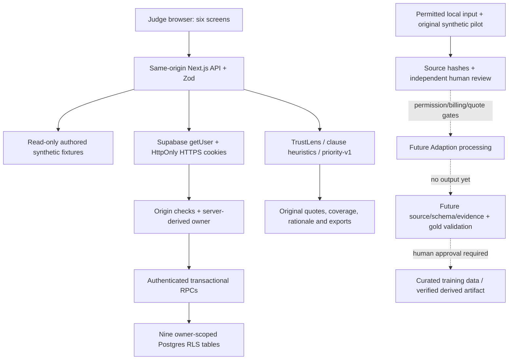

# Submission architecture and integration

Current live reference: https://insightflow-preview-demo.vercel.app/.

Solid paths are implemented. Dashed paths have not run. Authenticated SDK
connectivity is verified separately; it is not completed processing integration.

The browser uses application APIs, not privileged database credentials. Frozen
domain v1.0.0, additive Auth and batch protocols validate boundaries. Private
selection is discovered and reauthorized server-side; storing an ID grants no
access. Public fixtures and private snapshots share the repository interface.

CSV import preserves raw rows and exact batch-scoped groups, then atomically
persists feedback, patterns, heuristic annotations, issues and evidence. A content
hash makes identical same-owner retries idempotent. Issue UUIDs/actions persist;
workspace foreign keys, owner RPCs and RLS enforce isolation. Direct client table
writes remain denied. Sign-out clears private selection and rendered state.

TrustLens separates volume from distinct evidence. Priority uses severity and
disclosed evidence factors; repeats have no direct scoring weight. Unsupported
dates, customer counts, confidence, credits and evaluation metrics remain absent.

The official-artifact pipeline remains local and is excluded from deployment.
The 25-review original synthetic Adaption pilot keeps independent gold locally.
A future approved provider payload contains only review text and normalized
hashes. Returned completions would be training candidates, not independent
ground truth or proof of a trained model. No paid processing/output/quality gain
is claimed. See [current Adaption status](ADAPTION_SUBMISSION_STATUS.md) and
[hosted verification](PHASE7B_PREVIEW.md). Historical architecture notes describe
earlier phases and do not supersede this snapshot.
